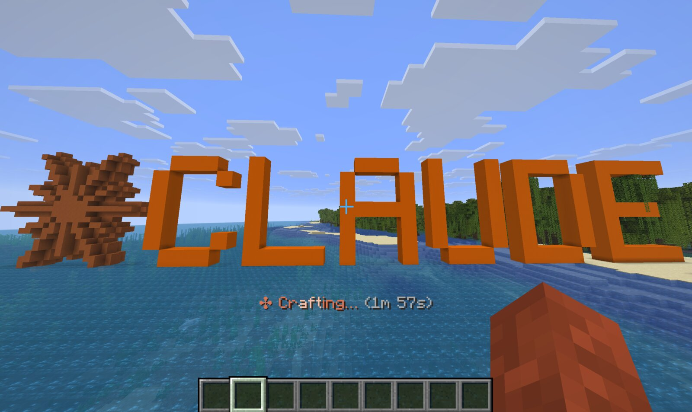
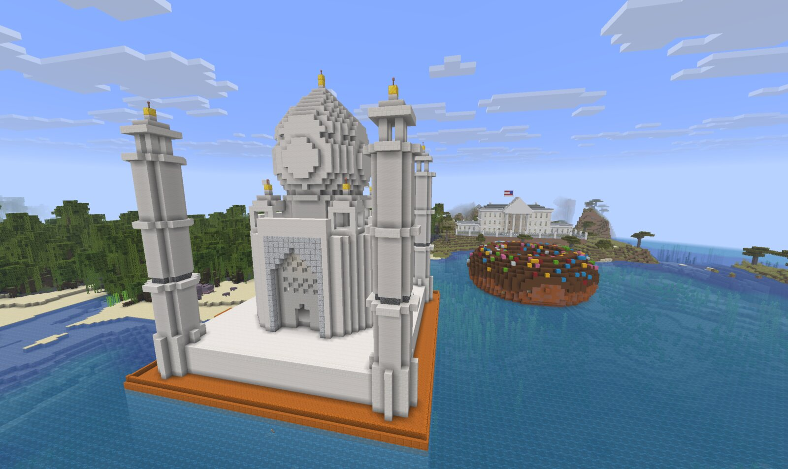
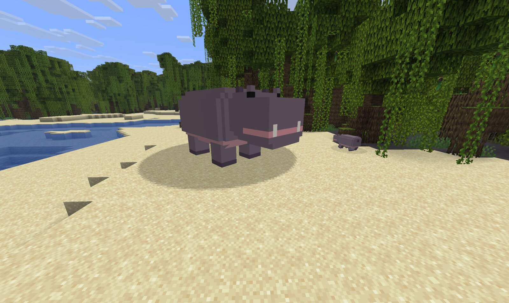

# ClaudeCraft

Play Minecraft with Claude. Type in chat and Claude builds, invents new items, blocks and creatures, and runs commands for you, live in your world.

**[Download the latest release](https://github.com/gavinsan33/claudecraft/releases/latest)** · Minecraft 26.3 · Fabric

## What Claude can do

### Build

"Build the Eiffel Tower over there." Blocks go up in front of you with sounds and particles while Claude designs the rest. It shapes terrain, uses WorldEdit-style tools for domes, towers and curves, and looks at its own work to fix what's off.

*A Taj Mahal, a giant donut and the White House, all built by Claude in one world.*

### Invent things that aren't in Minecraft

Ask for something that doesn't exist and Claude designs it on the spot and adds it to your world. Everyone sees it right away, with no resource packs and no restart.

- **Items.** "Make me a frost wand that freezes water when I right-click." Claude draws it like a vanilla item and gives it its own powers: weapons, food, real pickaxes and axes, armor you can wear, bows and throwables, and abilities on right-click, on hit, or while held or worn.
- **Blocks.** "Add ruby ore and a glowing mushroom lamp." You can place, mine and build with them like any other block. Ores can need the right pickaxe, drop gems and experience, and generate underground. Blocks can also face you when placed, store items, work with redstone, and grow or spread on their own. They can be animated too, like flickering fire that sets you alight or a shimmering portal you can step into.
- **Creatures.** "Spawn a family of hippos by the river." Mobs that walk, fly, swim or hop, with their own health, behavior, sounds and drops. You can tame them, ride them, breed them for babies, and get spawn eggs. They can have ranged attacks and special abilities, and appear on their own in the biomes they belong to.

*These hippos aren't in vanilla Minecraft. Claude designed them, including their look, animation and behavior, and spawned them in.*

Not quite right? Ask for changes ("make it bigger", "give it spots") and the new look shows up everywhere, even on copies already in the world.

- **Effects.** "Make a lightning gun" or "a black hole gun." Glowing laser beams, crackling lightning, energy waves, orbs with halos and spinning rings, shockwaves and sparks, drawn for real rather than with particles. A black hole can actually pull mobs in.

- **Dimensions.** "Make a moon I can visit." Whole new worlds, created instantly: alien hills under a purple sky, floating islands among the stars, endless caverns. Claude shapes the land, can build it from blocks it invented, fills it with its creatures, and can make portals that work like nether portals to get there and back.

Claude can add crafting, smelting and stonecutting recipes, so survival players can make what it invents. Everything also shows up in a ClaudeCraft tab in the creative inventory. Commands can use your inventions too (`/give @s custom:ruby`, `/summon custom:hippo`), and Claude can save a design to a library and load it into another world.

### And more

Claude can do anything a server operator can: give items, summon mobs, change the time and weather, teleport, set up redstone. It remembers the conversation for each world, so you can say "make the tower taller" later. If it builds something you don't like, `/claude undo`.

## Install

**Every player**, the host and anyone joining:

1. Install [Fabric Loader](https://fabricmc.net/use/) for Minecraft 26.3.
2. Download `claudecraft-<version>.jar` from the [latest release](https://github.com/gavinsan33/claudecraft/releases/latest) and put it in `.minecraft/mods`, along with [Fabric API](https://modrinth.com/mod/fabric-api).

**The host** also:

3. Installs [Claude Code](https://claude.com/claude-code) and logs in once by running `claude` in a terminal.
4. Starts a world (or hosts one with Essential) and types in chat.

To update, replace the old `claudecraft` jar in your mods folder with the new one from [Releases](https://github.com/gavinsan33/claudecraft/releases).

## Using it

Just type in chat. Claude replies as `[Claude]`, and the bar above your hotbar shows what it's doing while it works.

- `/claude stop`: stop Claude and any build in progress.
- `/claude undo [steps]`: undo Claude's block changes. One step is one request.
- `/claude reset`: start a fresh conversation.
- `/claude ask <message>`: talk to Claude without the chat trigger.
- `/claude status`

## Settings

The **ClaudeCraft…** button in the corner of the pause menu opens a menu for the multiplayer settings. Changes there apply right away and are saved:
- how many requests Claude works on at once
- whether friends can use their own Claude
- whether you use your own Claude

Only the host or an operator can change the world's settings.

Everything else is in `config/claudecraft/config.json` in your Minecraft folder. The most useful ones:

| Setting | Default | What it does |
|---|---|---|
| `triggerPrefix` | `""` | Only send chat that starts with this, e.g. `"@claude"`. Empty sends every message |
| `allowedPlayers` | `[]` | Who can talk to Claude. Empty means everyone |
| `commandPermissionLevel` | `2` | What Claude's commands can do. 2 allows `/give`, `/tp`, `/summon` and the like; `/op` and `/ban` need 3 or 4 |
| `maxConcurrentSessions` | `2` | How many requests Claude works on at once. Each is its own conversation; a player's follow-ups stay with the one handling them. `1` handles one request at a time |
| `model` | `""` | Which Claude model to use. Empty uses your Claude Code default |
| `animateBuilds` | `true` | `false` places builds instantly |
| `maxBuildSeconds` | `12` | Longest a single build animation takes |

You can also change how Claude behaves (chat style, building taste) in `config/claudecraft/system-prompt.md`. Changes apply on its next reply.

### Friends using their own Claude

When friends join your world, their messages normally go to your Claude and use your plan. A friend can run Claude on their own computer, with their own Claude Code account, instead:

1. You (the host) turn on **Friends can use their own Claude** in the ClaudeCraft menu, or set `"allowPlayerClaude": true`. Only players allowed by `allowedPlayers` can use it.
2. Your friend installs Claude Code, then turns on **Use my own Claude** in the menu, or sets `"useOwnClaude": true` in their own config.

When they join, they'll see "your messages go to Claude on this computer". Their Claude builds in your world through the same tools as yours. Its replies show in chat as `[Name's Claude]`. `/claude stop`, `/claude reset` and `/claude undo` cover it too. Everything goes through the normal Minecraft connection, so it works with Essential or any other way of joining.

## Good to know

- Every message Claude handles uses your Claude plan or API usage. With friends chatting, set a `triggerPrefix` so only messages meant for Claude are sent.
- Claude can only act inside Minecraft. It has no access to your files or terminal.
- Undo only lasts until the world closes, and doesn't cover chest contents.
- If Claude Code is installed somewhere unusual, set `claudePath` in the config.

## Building from source

`./gradlew build` puts the jar in `build/libs/`. `./gradlew runServer` starts a dev server, and `xvfb-run -a ./gradlew runClientGameTest` runs the in-game tests headless.
